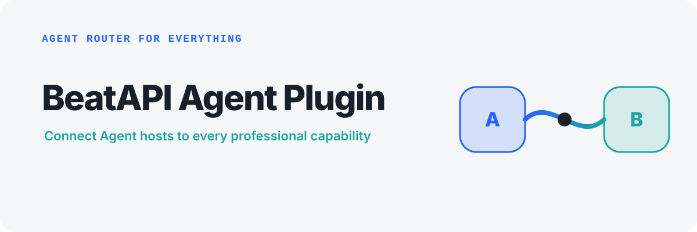
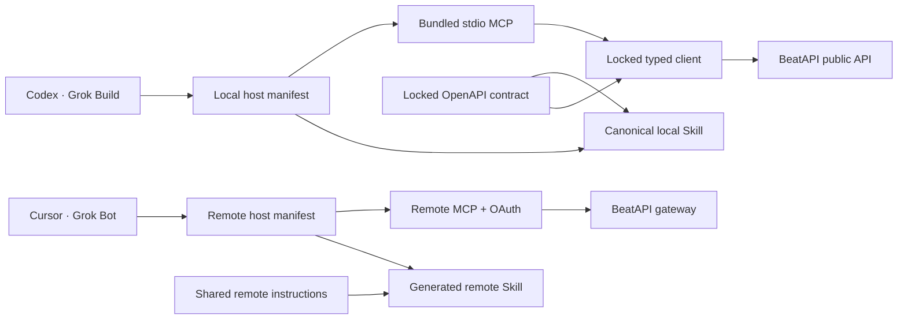

<p align="center">
  
</p>

<p align="center">
  <a href="https://beatapi.io/"><strong>Explore BeatAPI</strong></a> ·
  <a href="https://beatapi.io/dashboard/apikeys">Create an API key</a> ·
  <a href="https://docs.beatapi.io/">Docs</a> ·
  <a href="#quick-start">Quick start</a> ·
  <a href="#api-key-and-secret-safety">Security</a> ·
  <a href="#verification">Verification</a>
</p>

# BeatAPI Agent Plugin

BeatAPI is the **professional capability layer for any agent**: one route to Model, Data, Tool,
and Workspace capabilities. This plugin connects Codex, Cursor, Grok Bot, and
Grok Build to BeatAPI through host-specific connections and a locked public contract.

Cursor and Grok Bot now have a remote MCP + OAuth integration candidate. Its
dedicated OAuth client registration and authenticated host tests remain pending;
see [remote setup and release gates](cursor/README.md). Codex and Grok Build keep
their local stdio MCP. The separate OpenAI package was reported submitted by the
owner; this change does not rebuild or update that review snapshot.
This repository does not configure or deploy the hosted service.
See [public submission](submission/SUBMISSION.md) for the build and review gates.
The public listing is named **BeatAPI Agent Toolkit**; its stable package ID
remains `beatapi-agent-plugin`.

The remote Skill is general-purpose: social/web research, SEO keyword and competitor
analysis, text and decision models, image/video generation and media workflows.
Research, SEO analysis and creative production can be used independently or combined.
SEO traffic figures are estimates, and ranking positions are dated snapshots, not live tracking.
Social data is read/research
only, not social posting. Public execution tools are generated individually from
gateway capability contracts; local `capabilities_*` interfaces stay compatible.
`npm run submission:catalog -- --fetch` reads the anonymous catalog only and writes
tool definitions, fixed-reference bindings and exclusions under `dist/submission/`.
These artifacts still need the hosted gateway's OAuth/transport activation; generating them
does not deploy a remote server or prove that every listed capability succeeds.
Public packaging also requires a pinned v2 catalog and a matching anonymous SDK
tool scan, not just OAuth metadata. Probe reports distinguish blocked, OAuth-only
and metadata-matched states; none substitutes for real user/workflow review tests.

**DeepSeek Harness:** five independently installable bundles provide
[Social Research](packages/dsh-social), [Media Kit](packages/dsh-media),
[BeatBrowser](packages/dsh-browser), [BeatDesign](packages/dsh-design), and
[BeatGEO](packages/dsh-geo). See [setup and validation](harness/README.md).

For host-independent onboarding, give an Agent this instruction:

```text
set up https://beatapi.io/SKILL.md
```

The repository root [`SKILL.md`](SKILL.md) mirrors that setup contract; the
detailed installable Skill remains under `skills/beatapi-video/`.

For hosts that support remote MCP, BeatAPI also provides the stable Hosted MCP
endpoint `https://beatapi.io/mcp` with three provider-neutral tools:
`capabilities_search`, `capabilities_inspect`, and `capabilities_run`. The
bundled local MCP keeps focused workflow, upload, account, and task tools for
host-native use; both surfaces discover model IDs dynamically.

## How it routes

```text
Cursor · Grok Bot -> remote Skill + OAuth MCP -> BeatAPI
Codex · Grok Build -> local Skill + stdio MCP -> BeatAPI
```

The plugin exposes only capabilities supported by its current public contract
and the live catalog. Tool and Workspace coverage expands through reviewed
interfaces and integrations rather than README-only claims.

Local hosts use the canonical `beatapi-video` Skill and bundled MCP client.
Remote hosts use a generated Skill sharing the public remote instructions:

| Host | Plugin metadata | MCP configuration | Authentication |
| --- | --- | --- | --- |
| Codex | `.codex-plugin/plugin.json` | `.mcp.json` | BeatAPI CLI credential manager or host environment |
| Cursor | `.cursor-plugin/plugin.json` | Remote `mcp.json` | Host-managed OAuth (candidate) |
| Grok Bot | Cursor/Grok Bot remote distribution | Remote HTTPS connector | Host-managed OAuth (candidate) |
| Grok Build | `.grok-plugin/plugin.json` | `.mcp.json` | BeatAPI CLI credential manager or host environment |

Marketplace acceptance is a separate review step. The presence of a manifest
in this repository does not mean a listing is already live.

## Quick start

For Cursor and Grok Bot, use the [remote connection guide](cursor/README.md).
The following quick start is for local Codex/Grok Build installations:

1. Create a key in [Dashboard → API Keys](https://beatapi.io/dashboard/apikeys).
2. Install the plugin for your host using one of the paths below.
3. Configure the key outside the conversation. For local uploads, also set
   `BEATAPI_UPLOAD_ROOTS` to directories containing files you selected.
4. Ask the agent to discover current models before creating a paid task.

For example:

```text
Use $beatapi-video to list current video models, choose one that supports image
references, and create a 10-second 9:16 product shot from these images.
```

Requirements: Node.js 20.19+ or 22.12+, a BeatAPI account, and network access to
`https://api.beatapi.io`.

## Install on Cursor and Grok Bot

Build the remote-only candidate:

```bash
npm run cursor:build
npm run cursor:check
```

The output is `dist/cursor`: plugin metadata, remote MCP configuration, shared
remote Skill, logo and documentation only. No local Node runtime or API key is
required by the remote plugin. Operator OAuth registration and real login tests
are still required; do not advertise this candidate as ready to install publicly.
See [callback constraints, installation and acceptance](cursor/README.md).

## Install on Grok Build

Validate and install a source checkout with the current Grok Build CLI:

```bash
npm ci
npm run verify
grok plugin validate .
grok plugin install .
```

The recommended credential path is the operating-system credential manager:

```bash
npm install --global beatapi@0.3.0
beatapi auth login
export BEATAPI_CLI_PATH="$(command -v beatapi)"
```

The reviewed npm integrity for `beatapi@0.3.0` is
`sha512-zqWqP2CSYbbPLdy3qo8umEE4U4YiMgKrtt5pnOw14ErcaMUSTU5cmxvLw02Lkkn+7mS3w+pTvxuAHTFiqAafkA==`.

Alternatively, export the key only in the shell that launches Grok Build:

```bash
read -s BEATAPI_API_KEY
export BEATAPI_API_KEY
printf '\n'
grok
```

## Install on Codex

Build and add the repository-local marketplace:

```bash
npm ci
npm run verify
codex plugin marketplace add ./dist/marketplace
codex plugin add beatapi-agent-plugin@beatapi-local
```

Then run `beatapi auth login` and set `BEATAPI_CLI_PATH` to the CLI's absolute
executable path, or set `BEATAPI_API_KEY` in the environment that launches
Codex. Restart the desktop app after installation.

## Model coverage

Model IDs are discovered at runtime rather than hardcoded into the plugin:

| Surface | Discovery | Stable execution interface |
| --- | --- | --- |
| Text models | Authenticated `GET /v1/models` | Non-streaming `POST /v1/responses` with the selected model ID |
| Image models | Public `GET /v1/media/models` | `beatapi_create_image({ model, parameters })` |
| Video models | Public `GET /v1/media/models` | `beatapi_create_video({ model, parameters })` |
| Effects | Public list and detail endpoints | Versioned Effect task creation |
| Workflows | Public `GET /v1/workflows` | Music Video, Ecommerce Video, Video Analysis, and Realtime tools |

The provider-neutral capability catalog unifies those surfaces with Social
Data. As verified on 2026-09-22, full pagination returned 60 Model
capabilities, 1,000+ Data actions, and three Workflows. These are dated catalog
observations, not plugin constants; always Search and Inspect again.

The generic image and video tools accept a current model ID plus its
model-specific `parameters`. New models can therefore appear in discovery
without requiring a new plugin release. The bundled OpenAPI snapshot remains the
source for each model's supported fields and constraints.

## What the plugin can do

- discover text models, image/video model aliases, workflows, and published
  Effects;
- search and inspect Model, Social Data, and Workflow contracts through the
  Hosted MCP or official CLI when a provider-neutral catalog flow is needed;
- create non-streaming text responses when the user explicitly requests
  BeatAPI text generation;
- create image, video, Effect, Video Analysis, Music Video, and Ecommerce Video
  tasks;
- upload explicitly selected local images, audio, MP4/MOV video, and SRT files
  from configured trusted directories;
- inspect, edit, materialize, and compose Music Video storyboard shots;
- inspect and close existing short-lived Realtime Video sessions;
- poll asynchronous tasks until a terminal or actionable state;
- inspect USD balance, usage, and active concurrency;
- inspect, update, and delete existing webhook endpoints.

The bundled local MCP server exposes 26 focused tools. Paid mutations are
labeled as such; read-only and destructive annotations are set independently.
This is intentionally distinct from the Hosted MCP's three meta-tools.

Realtime-session and webhook creation return one-time secrets. Those two create
operations are intentionally not exposed to an agent until a host secret broker
can keep both the secret and its retrieval handle outside model authority. Use
trusted server-side application code or the BeatAPI dashboard for that setup.

## API key and secret safety

Never paste an API key into a prompt. The plugin excludes credential fields and
recursively rejects credential-shaped values in open-ended model parameters.

- Cursor and Grok Bot use host-managed OAuth; no API key variables or shell fallback
  are included in their remote connection.
- Codex and Grok Build can use `beatapi auth login` or inherit
  `BEATAPI_API_KEY` from the launching process.
- Responses are recursively sanitized for credential-like fields and bearer
  values.
- Local uploads are disabled until `BEATAPI_UPLOAD_ROOTS` is configured, then
  canonical paths are confined to those trusted directories and symlinks are
  rejected.
- One-time-secret creation operations are not exposed through this agent
  package.
- The default endpoint is `https://api.beatapi.io`; overrides must be exact
  HTTPS origins without credentials, paths, queries, or fragments and require a
  separate explicit operator trust flag.

## Architecture



The host-specific manifests are thin adapters. Local hosts share the bundled
runtime and locked client. Remote hosts share the hosted gateway and public
instructions; authentication and billing are not reimplemented in the plugin.

## Package layout

| Path | Purpose |
| --- | --- |
| `.codex-plugin/plugin.json` | Codex presentation and component manifest |
| `.cursor-plugin/plugin.json` | Cursor and Grok Bot remote plugin metadata and component paths |
| `.grok-plugin/plugin.json` | Grok Build marketplace metadata |
| `.mcp.json` | Codex and Grok Build local stdio configuration |
| `mcp.json` | Cursor and Grok Bot remote MCP with a dedicated public OAuth client |
| `cursor/` | Remote host instructions, generated Skill and acceptance guide |
| `mcp/server.mjs` | Dependency-free bundled MCP runtime |
| `skills/beatapi-video/` | Synchronized canonical BeatAPI Skill |
| `contract/` | Locked BeatAPI OpenAPI snapshot and provenance |
| `generated/` | Skill and typed-client provenance locks |

Do not edit synchronized Skill or client files directly. Refresh them through
`npm run skill:sync` and `npm run runtime:sync`.

## Claude plugin candidate

The self-contained Claude directory source is [`claude/beatapi`](claude/beatapi).
It reuses the shared remote Skill and OAuth MCP service with a dedicated Claude
client. Run `npm run claude:build`, `npm run claude:check`, and
`claude plugin validate ./claude/beatapi`. See its README for host-specific
release gates; packaging does not establish authenticated compatibility.

## Publishing paths

1. **Cursor Marketplace and Grok Bot:** submit this public repository once at
   `https://cursor.com/marketplace/publish` after owner review and merge.
2. **Grok Build Marketplace:** add a SHA-pinned entry for this public repository
   to `xai-org/plugin-marketplace` and regenerate its component index.
3. **Codex local marketplace:** `npm run marketplace:build` creates an
   installable marketplace and ZIP under `dist/`.
4. **OpenAI Plugin Directory:** the public target is remote MCP + Skill using
   host-managed OAuth, without local software or CLI prerequisites. Run
   `npm run submission:check` for offline source validation. After the gateway's
   actual OAuth endpoint is deployed, `npm run submission:build -- --mcp-config
   /absolute/path/to/actual-remote-mcp.json --catalog
   dist/submission/remote-catalog.json --demo-recording-url
   "$BEATAPI_REVIEW_DEMO_URL"` performs read-only discovery checks
   and builds `dist/submission/beatapi-agent-plugin-remote.zip`. Verify recording
   playback and reviewer access before supplying its URL. Missing recordings,
   mismatched tools or API-key-only endpoints fail closed; a Skill-only substitute is not produced.
   Local marketplace and Harness packages remain separate and unchanged.

For Muse and other remote-MCP hosts, connect to the Hosted MCP endpoint rather
than installing this local plugin. A runnable Muse setup guide lives in the
[`beatapi-examples`](https://github.com/BeatAPI/beatapi-examples/tree/main/integrations/muse)
repository. Documentation does not imply an approved directory listing.

See [submission/SUBMISSION.md](submission/SUBMISSION.md) for the separate public
directory review boundary.

## Verification

```bash
npm run verify
python3 ~/.codex/skills/.system/plugin-creator/scripts/validate_plugin.py .
grok plugin validate .
```

Verification covers OpenAPI drift, synchronized Skill/client sources, Cursor
and Grok manifests, TypeScript, MCP protocol behavior, credential rejection and
redaction, upload-root confinement and size limits, deterministic bundles, and
release packaging.

## Contributing

Issues and pull requests are welcome. Please keep new claims tied to executable
source, tests, or the current public OpenAPI contract, and run `npm run verify`
before opening a pull request.

## License

MIT

<p align="center">
  Built by <a href="https://beatapi.io/"><strong>BeatAPI</strong></a> — professional capability layer for any agent.
</p>

## Unified capability and Web tools (0.4.0)

The bundled local MCP now exposes `capabilities_search`, `capabilities_inspect`,
`capabilities_run`, `web_search`, `web_read`, `web_map`, and `web_research`, matching
remote MCP at `https://beatapi.io/mcp`. Existing `beatapi_*` tools remain available.
Search/Inspect require no key. Run and Web calls use host-configured credentials
or the CLI credential store (requires CLI 0.4.0). Never pass a key in tool arguments.

Search supports compact/full views and function grouping. Run supports start,
status and result, plus preview, fields and max_items. A stored result is free to
read within one hour. Research may return a task; poll instead of starting again.
Models and prices come from live discovery; no list of new model IDs is embedded.
